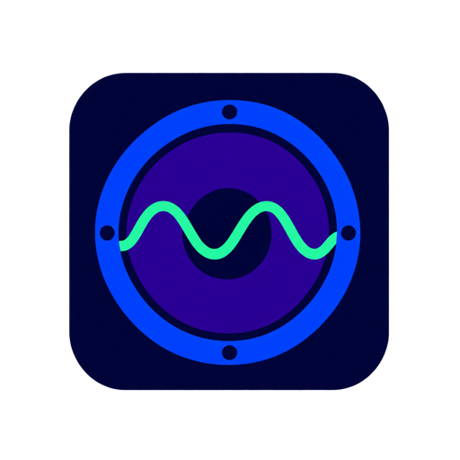
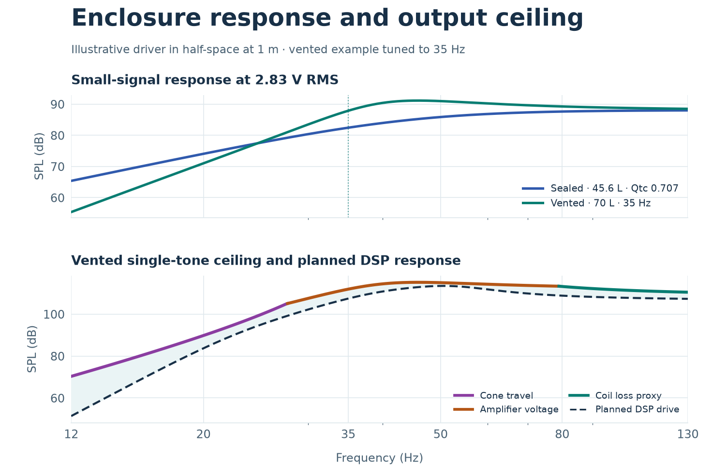
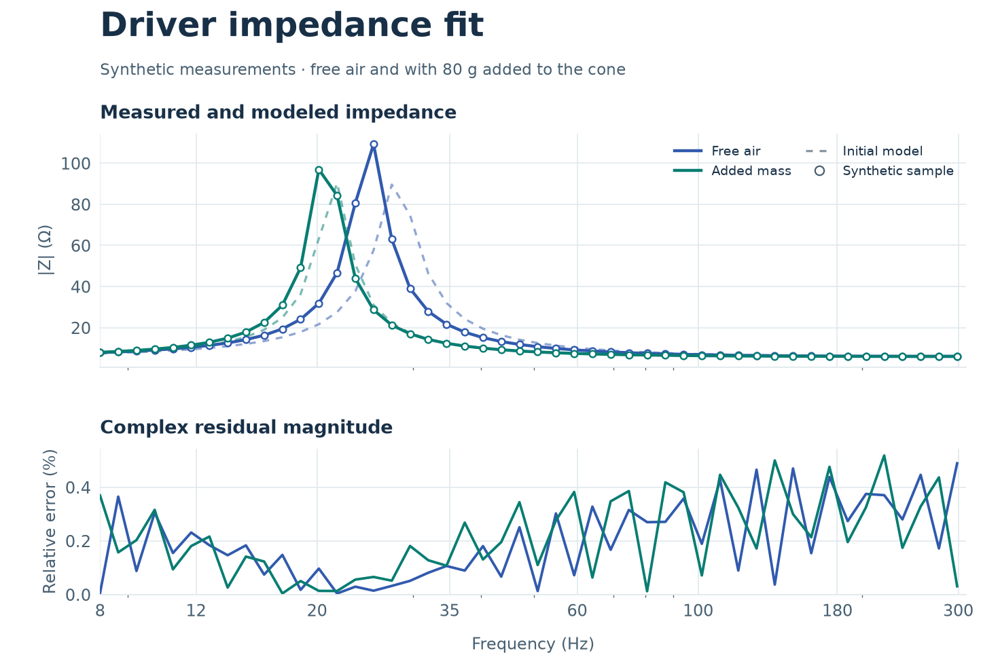

<p align="center">
  
</p>
<h1 align="center">Electroacoustics</h1>
<p align="center">
  <a href="https://github.com/0xdoublesharp/electroacoustics/actions/workflows/ci.yml"></a>
  <a href="https://app.codecov.io/gh/0xdoublesharp/electroacoustics"></a>
  <a href="vitest.config.ts"></a>
  <a href="https://www.npmjs.com/package/@0xdoublesharp/electroacoustics"></a>
  <a href="package.json"></a>
  <a href="verification/lean/README.md"></a>
  <a href="LICENSE"></a>
</p>

Dependency-free TypeScript solvers for low-frequency loudspeaker design and measurement. Size a sealed, vented, or passive-radiator enclosure, predict its frequency response, and see where cone travel, port speed, or the amplifier limits its output. Compare the prediction with measured impedance and fit driver or enclosure parameters.

## Install

```sh
npm install @0xdoublesharp/electroacoustics
```

The package ships ESM and TypeScript declarations for Node.js 22 or later and modern browser bundlers. Supply dimensions, electrical values, and air properties in SI units.

## Size and simulate an enclosure

```ts
import {
  massControlledSplDb,
  sealedVolumeForQtc,
  summarizeResponse,
  sweepCircuit,
  ventLengthForTuning,
  type CircuitInput,
} from '@0xdoublesharp/electroacoustics'

const driver = {
  fsHz: 25, vasM3: 0.08, qes: 0.45, qms: 8,
  reOhms: 6, leHenries: 0.0007, sdM2: 0.05,
}
const medium = { densityKgM3: 1.2041, soundSpeedMps: 343 }
const qts = 1 / (1 / driver.qes + 1 / driver.qms)
const alignment = sealedVolumeForQtc({ ...driver, qts }, 0.707)
const sealed: CircuitInput = {
  driver, medium, volumeM3: alignment.volumeM3, voltageRms: 2.83,
  leakageQuality: 15, absorptionQuality: 30,
}

const areaM2 = 0.012
const volumeM3 = 0.07
const vented: CircuitInput = {
  ...sealed, volumeM3,
  port: {
    areaM2,
    effectiveLengthM: ventLengthForTuning(areaM2, volumeM3, 35, medium.soundSpeedMps),
    quality: 7,
  },
}

const grid = { minHz: 12, maxHz: 130, relativeTolerance: 0.005, maxPoints: 768 }
const sweep = sweepCircuit(vented, grid)
const summary = summarizeResponse(sweep.points, {
  band: { minHz: 30, maxHz: 120 },
  reference: { kind: 'explicit', splDb: massControlledSplDb(vented) },
})
console.log(summary.f3Hz, summary.f6Hz, summary.f10Hz, summary.minimumImpedance)
```

`createCircuit(input)(40)` evaluates a single frequency. `sweepCircuit` uses adaptive sampling and returns complex pressure and impedance, SPL, cone excursion, port speed, current, and power. Response summaries include ripple, group delay, minimum impedance with its frequency, and low-side cutoffs relative to an explicit level or the selected band's peak.

The sealed sizing calculation uses ideal acoustic compliance volume. Apply cabinet displacement and any fill model before passing the volume to the circuit. A lumped vent length is effective length, including end corrections. For a distributed vent, use `port.ductPath` with straight, conical, or exponential sections. The duct API calculates tuning, impedance, equivalent inertance length, and the maximum particle speed per unit inlet volume flow. Use `ductVolumeForTuning` for a fixed duct or `solveDuctLengthForTuning` with caller-supplied path and cavity volume functions to size a duct along a buildable interval.

## Compare output and DSP headroom

Continue with the unfiltered `vented` sweep above. The filter models a fourth-order Butterworth high-pass and a digital peaking EQ. The limits apply to each sinusoidal tone at the amplifier terminals.

```ts
import {
  analyzeOutputLimit,
  operatingSourceFromCircuit,
  type FilterChain,
} from '@0xdoublesharp/electroacoustics'

const filter: FilterChain = {
  highpassHz: 23,
  highpassType: 'BW24',
  digital: {
    sampleRateHz: 48000,
    stages: [{ kind: 'peaking', frequencyHz: 52, gainDb: 4, q: 2 }],
  },
}

const source = operatingSourceFromCircuit(vented, sweep.points, {
  xmaxMeters: 0.012,
  ratedPowerWattsPerDriver: 180,
})
const output = analyzeOutputLimit(source, {
  filter,
  driveVoltageRms: 24,
  maxPortMach: 0.07,
  maxAmplifierVoltageRms: 45,
  maxAmplifierCurrentRms: 6,
})
console.table(output.points.map(({ frequency, maxSplDb, headroomDb, limitingFactor }) => ({
  frequency, maxSplDb, headroomDb, limitingFactor,
})))
```



The tightest constraint sets the ceiling at each frequency. Supported constraints include cone travel, port Mach, the coil-loss proxy, amplifier voltage or current, and passive radiator travel. `headroomDb` is the distance from the planned response to the ceiling. `bandInputLimit` gives the source voltage at unity DSP gain that meets the active limits across the sampled band. Pass unfiltered points when supplying `filter` to the operating functions.

`composeFilters` combines an LR24 or BW24 high-pass, an LR24 low-pass, gain, delay, and digital EQ. `designBiquad` returns coefficients for peaking, low-shelf, and high-shelf stages. Pass normalized coefficients to `biquadTransfer` or include them in a chain as `kind: 'biquad'`. Digital stages require the device sample rate. [Audio EQ Cookbook](https://www.w3.org/TR/audio-eq-cookbook/)

## Tune a passive radiator

```ts
import { passiveRadiatorMassForTuning, sweepCircuit } from '@0xdoublesharp/electroacoustics'

const radiator = {
  movingMassKg: 0.09, complianceMPerN: 0.001,
  mechanicalResistanceNsPerM: 1.2, sdM2: 0.04, quantity: 2,
}
const mass = passiveRadiatorMassForTuning(radiator, 0.06, medium, 30)
const passive: CircuitInput = {
  ...sealed, volumeM3: 0.06,
  passiveRadiator: { ...radiator, movingMassKg: mass.movingMassKg },
}
const result = sweepCircuit(passive, grid)
console.log(mass.addedMassKg, result.referenceResonanceHz)
```

The mass change is per radiator. A negative value calls for removing mass. The sweep includes the radiators' summed volume flow and individual peak travel. Pass `maxRadiatorExcursionPeakM` to `analyzeOutputLimit` to include their travel in the output ceiling. [Small's passive-radiator analysis](https://sdlabo.jp/archives/Passive-Radiator%20Loudspeaker%20Systems%20Parts%201--2.pdf)

## Fit impedance measurements

Pass samples as frequency and impedance magnitude or complex impedance. The paired driver fit accepts a free-air sweep and a sweep with known added mass or known sealed test-box volume. Supply the cone area and an initial driver estimate.

```ts
import { createDriverImpedance, fitDriverImpedance } from '@0xdoublesharp/electroacoustics'

const condition = { kind: 'added-mass', massKg: 0.08 } as const
const frequencies = Array.from({ length: 48 }, (_, index) => 8 * 2 ** (index / 9))
const freeAirModel = createDriverImpedance(driver, medium)
const loadedModel = createDriverImpedance(driver, medium, condition)
const freeAir = frequencies.map((frequency, index) => {
  const z = freeAirModel(frequency)
  return { frequency, impedanceOhms: { re: z.re + 0.03 * Math.sin(index * 1.7), im: z.im } }
})
const samples = frequencies.map((frequency, index) => {
  const z = loadedModel(frequency)
  return { frequency, impedanceOhms: { re: z.re, im: z.im + 0.03 * Math.cos(index * 1.1) } }
})
const fit = fitDriverImpedance({
  initial: { ...driver, fsHz: 28, vasM3: 0.10, qms: 6.5 },
  medium, freeAir, perturbed: { condition, samples },
})
console.log(fit.driver, fit.rmsRelativeError, fit.converged)
```



Replace the synthetic samples with readings from your measurement workflow. `impedanceResiduals` compares any impedance model with measured samples. `fitEnclosureImpedance` fits bounded parameters such as acoustic volume, port loss, or lumped effective length while holding the driver fixed. Choose either leakage or absorption for an impedance-only fit. They contribute through the same circuit branch and cannot be separated by impedance alone. Check residuals and parameter bounds before using a fit in a design. [KLIPPEL linear parameter measurement](https://klippel.de/products/rd-system/modules/lpm-linear-parameter-measurement.html)

## API reference

| Task | Exports |
| --- | --- |
| Solve a circuit and sweep a band | `createCircuit`, `sweepCircuit`, `referenceResonanceHz` |
| Size sealed or vented alignments | `sealedAlignment`, `sealedVolumeForQtc`, `ventTuningHz`, `ventLengthForTuning`, `ductVolumeForTuning`, `solveDuctLengthForTuning` |
| Evaluate a distributed duct | `ductPathImpedance`, `ductPathTuning`, `ductPathTuningResidual`, `ductPathEquivalentLength`, `ductPathPeakVelocityRatio` |
| Tune a passive radiator | `passiveRadiatorResonanceHz`, `passiveRadiatorTuningHz`, `passiveRadiatorMassForTuning` |
| Summarize a response | `summarizeResponse`, `responseGroupDelayMs`, `massControlledSplDb` |
| Build a filter | `composeFilters`, `lr24Transfer`, `lr24AttenuationDb`, `bw24Transfer`, `bw24AttenuationDb`, `designBiquad`, `biquadTransfer` |
| Check drive and output | `operatingSourceFromCircuit`, `analyzeOperatingDrive`, `analyzeFilteredVoltageLimit`, `analyzeOutputLimit` |
| Compare measurements and fit parameters | `createDriverImpedance`, `impedanceResiduals`, `fitDriverImpedance`, `fitEnclosureImpedance` |
| Refine a grid and compare parameter scenarios | `sampleAdaptive`, `analyzeSensitivity` |
| Work with complex phasors | `c`, `add`, `sub`, `mul`, `div`, `reciprocal`, `magnitude` |

For integration with a cabinet design tool such as Subchecker, pass the resolved SI driver, net acoustic volume, and duct geometry to the shared solver. The application can continue to own cabinet layout, fill presets, unit conversion, and measurement file parsing. The packed-package check exercises this boundary with a clean TypeScript consumer.

## Model conventions

- Voltage, current, pressure, and volume-flow phasors use RMS values and `exp(jωt)`. Excursion and port speed are sinusoidal peak values.
- Pressure uses half-space radiation at 1 m by default. It combines the active cone, port or passive radiator, and radiating leakage flows without propagation delay. Electrical input power and copper `I²R` loss are reported separately.
- Multiple identical drivers can share a cavity with `quantity` and `seriesDrivers`. A loss quality of `Infinity` removes the corresponding loss branch.
- Adaptive sweeps report numerical convergence and unresolved intervals. Sensitivity varies one supplied parameter at a time on a common grid. Group delay requires adjacent samples close enough to resolve phase rotation.
- The circuit uses linear drivers, a lumped cavity, and rigid one-dimensional ducts. Output ceilings come from small-signal scaling. Port noise, thermal compression, and broadband power handling require measurements or separate models.

## Development

Run `npm ci` and `npm run check` for typechecking, tests with 100% statement, branch, function, and line coverage, and an install test of the npm archive. The local Lean 4 project checks circuit, tuning, operating-limit, and design identities in exact arithmetic. Its README lists the checked assumptions and commands. [Contributing](CONTRIBUTING.md) · [Lean proofs](verification/lean/README.md) · [Release policy](PUBLISHING.md) · [MIT license](LICENSE)
